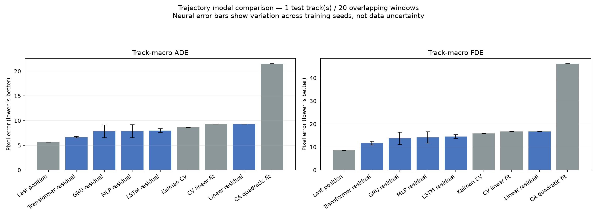

# 블랙박스 영상 기반 주변 차량 궤적 예측

> YOLO26s 차량 검출·BoT-SORT 추적부터 GRU 학습과 9개 모델 비교까지
>
> 현재 기준본: `그나마.mp4`의 20~30초 구간, 대상 차량 source track ID `5`  
> 작성 기준일: 2026-10-13

이 문서는 이전에 잘못 선택한 구간·대상 차량 결과를 제외하고, 현재 남아 있는 최신 실행 결과만 정리한다.

## 1. 프로젝트 목표와 전체 흐름

블랙박스 영상에서 차량을 검출하고 차량별 ID로 추적한 뒤, 영상 좌표를 시계열 데이터로 변환하여 **대상 차량을 제외한 주변 차량의 미래 위치**를 예측하는 것이 목표다. 마지막에는 단일 GRU만 평가하지 않고, 물리 기반 기준선과 여러 학습 모델을 같은 데이터 분할과 지표로 비교했다.

```text
원본 영상 20~30초
  → YOLO26s 차량 검출
  → BoT-SORT 차량별 ID 추적
  → tracks.csv 관측 좌표 생성
  ├─ 대상 차량 ID 5 관측 궤적 정리
  └─ 대상 차량을 제외한 주변 차량 학습 윈도우 생성
       → 9개 궤적 예측 방법 비교
       → ADE·FDE 평가
```

## 2. 실행 환경과 가상환경

### 2.1 `venv`를 만든 이유

`venv`는 Python 자체에 포함된 가상환경 기능이다. 프로젝트별 Python 실행 파일과 설치 패키지를 별도 폴더에 두어, 전역 Python 환경 및 다른 프로젝트와의 패키지 버전 충돌을 막는다.

가상환경 자체가 모델을 학습시키는 것은 아니다. **모델을 실행·학습하는 데 필요한 라이브러리 버전을 분리하고 재현성을 높이는 역할**을 한다.

```powershell
py -3.14 -m venv .venv
.\.venv\Scripts\Activate.ps1
```

핵심 설치 명령은 다음과 같다.

```powershell
python -m pip install torch torchvision --index-url https://download.pytorch.org/whl/cu128
python -m pip install -U ultralytics opencv-python
```

현재 확인된 실행 환경은 다음과 같다.

| 항목 | 버전·상태 | 역할 |
|---|---:|---|
| Python | 3.14.3 | 스크립트 실행 환경 |
| PyTorch | 2.11.0+cu128 | 딥러닝 텐서 연산, CUDA, 모델 학습 |
| TorchVision | 0.26.0+cu128 | PyTorch 비전 보조 패키지. 현재 사용자 스크립트에서 직접 import하지는 않음 |
| Ultralytics | 8.4.176 | YOLO 모델 로드·추론·추적 인터페이스 |
| OpenCV | 5.0.0.93 | 영상 읽기, 프레임 처리, 결과 영상 저장 |
| NumPy | 2.5.2 | 좌표·속도·보간 등 수치 계산 |
| Matplotlib | 3.11.2 | ADE/FDE 비교 그래프 생성 |
| GPU | NVIDIA GeForce RTX 4060 | CUDA 학습·추론 |
| Python 표준 라이브러리 | `csv`, `json`, `argparse`, `pathlib` 등 | CSV/JSON 저장, CLI 옵션, 경로 처리 |

## 3. YOLO26s 검출과 BoT-SORT 추적

### 3.1 YOLO는 무엇인가

YOLO는 이미지 한 장에서 객체의 위치를 바운딩 박스와 클래스로 한 번에 추정하는 **객체 검출 신경망**이다. 문장을 생성하는 LLM과는 입력·출력·목적이 다르다.

`yolo26s.pt`는 COCO 계열 클래스에 대해 미리 학습된 YOLO26의 small 크기 가중치 파일이다. 이번 블랙박스 영상으로 새로 학습한 모델은 아니다.

- **YOLO26s**: 각 프레임에서 차량 박스, 클래스, 신뢰도를 검출한다.
- **BoT-SORT**: 연속 프레임의 검출 결과를 연결하여 차량별 임시 `track_id`를 부여한다.
- `track_id`는 이번 실행 안에서만 유효하며, 재실행하거나 가림·재등장이 발생하면 달라질 수 있다.

빠른 확인에 사용한 YOLO CLI 형식은 다음과 같다.

```powershell
yolo track model=yolo26s.pt `
  source="C:\Users\User\Desktop\그나마.mp4" `
  tracker=botsort.yaml `
  device=0 imgsz=960 `
  conf=0.25 iou=0.4 `
  nms=True agnostic_nms=True `
  vid_stride=1 half=True `
  save=True show=True `
  project=runs name=cutin_clean `
  'classes=[2,3,5,7]'
```

| 옵션 | 의미 |
|---|---|
| `device=0` | 첫 번째 CUDA GPU 사용 |
| `imgsz=960` | 추론 입력 해상도 기준. 작은 차량 검출을 위해 비교적 크게 설정 |
| `conf=0.25` | 신뢰도 0.25 미만 검출 제거 |
| `iou=0.4` | NMS에서 겹친 박스를 정리하는 IoU 기준 |
| `agnostic_nms=True` | 클래스가 달라도 동일 물체로 크게 겹치면 중복 박스 억제 |
| `vid_stride=1` | 프레임을 건너뛰지 않고 처리 |
| `half=True` | GPU에서 FP16 추론으로 속도·메모리 효율 향상 |
| `classes=[2,3,5,7]` | COCO 기준 car, motorcycle, bus, truck 허용 |

### 3.2 트럭이 없는데 `truck` 클래스도 받은 이유

영상에 실제 트럭이 없더라도 검출기는 같은 승용차를 프레임에 따라 `car`, `truck`, `bus` 등으로 흔들리게 분류할 수 있다.

현재 후처리 결과의 분류 행 수는 다음과 같다.

| YOLO 분류 | 검출 행 수 |
|---|---:|
| car | 1,312 |
| truck | 172 |
| bus | 3 |

대상 차량 ID 5도 `car` 278회, `truck` 4회로 분류됐다. 따라서 `classes=2`만 사용하면 같은 차량의 일부 프레임이 사라져 궤적 연속성이 깨질 수 있다.

현재 목적은 차종 분류보다 **차량 궤적의 연속성**이므로 `[2,3,5,7]`을 유지하고 모두 `vehicle`로 묶었다. 이후 차종 정확도가 더 중요해지면 `classes=2`와 A/B 비교하는 것이 좋다.

## 4. 현재 기준 구간의 추적 데이터 생성

최종 기준 데이터는 구간 지정과 CSV 후처리를 함께 수행하는 `extract_tracks.py`로 만들었다.

```powershell
.\.venv\Scripts\python.exe .\extract_tracks.py `
  --source 'C:\Users\User\Desktop\그나마.mp4' `
  --start 20 `
  --end 30 `
  --output '.\outputs\tracking_custom_v1'
```

명령어에서 생략되어 기본값으로 적용된 설정은 YOLO26s, BoT-SORT, GPU 0, `imgsz=960`, `conf=0.25`, `iou=0.40`, 차량 클래스 `[2,3,5,7]`이다.

| 항목 | 결과 |
|---|---:|
| 처리 구간 | 원본 영상 약 20~30초 |
| 영상 크기 | 1280×720 |
| FPS | 약 30.0724 |
| 처리 프레임 | 301장 |
| 후처리 전 검출 | 1,489행 |
| 후처리 후 검출 | 1,487행 |
| 제거한 중첩 오검출 | 2개 |
| 생성된 track ID | 57개 |

후처리에서는 큰 차량 박스 안에 포함된 작은 차량 박스 2개를 `nested_inside_vehicle`로 제거했다.

### 4.1 CSV 좌표 기준

영상 좌측 상단이 `(0, 0)`이고, 오른쪽으로 갈수록 x가 증가하며 아래쪽으로 갈수록 y가 증가한다.

- `x1, y1, x2, y2`: 검출 박스의 왼쪽 위와 오른쪽 아래 좌표
- `center_x, center_y`: 박스 중심
- `bottom_center_x, bottom_center_y`: 박스 하단 중앙. 차량이 도로와 닿는 지점에 가까워 궤적 대표점으로 사용

```text
bottom_center_x = (x1 + x2) / 2
bottom_center_y = y2
x_norm = bottom_center_x / 1280
y_norm = bottom_center_y / 720
```

이 값은 **영상 픽셀 좌표**다. 실제 도로상의 미터 좌표나 조감도 좌표가 아니므로 원근감, 카메라 흔들림, 자차 움직임의 영향을 함께 받는다.

## 5. 대상 차량 궤적 분리

대상 차량은 source track ID `5`로 정했다.

```powershell
.\.venv\Scripts\python.exe .\make_target_track.py `
  --source 'C:\Users\User\Desktop\그나마.mp4' `
  --tracks '.\outputs\tracking_custom_v1\tracks.csv' `
  --track-id 5 `
  --start 20 `
  --end 30 `
  --max-gap 4 `
  --output '.\outputs\target_correct_v1'
```

| 항목 | 결과 |
|---|---:|
| 대상 차량 | source track ID 5 |
| 실제 관측 좌표 | 282행 |
| 짧은 누락 구간 보간 | 14행 |
| 최종 CSV | 296행 |
| 출력 영상 | 301프레임 |

프레임 818~822는 5프레임 연속 누락됐다. `max-gap=4`보다 길기 때문에 임의 보간하지 않고 비워 두었다.

> **중요:** `target_track.csv`는 미래 위치 예측 결과가 아니다. 영상에서 실제로 관측된 대상 차량의 이동 궤적을 시간순으로 정리하고, 짧은 누락만 선형 보간한 데이터다.

## 6. 주변 차량 GRU 미래 궤적 예측

여기서 사용한 모델은 `GNU`가 아니라 **GRU(Gated Recurrent Unit)**다. GNU는 운영체제·자유 소프트웨어 프로젝트 이름이고, GRU는 시간 순서가 있는 데이터를 처리하는 순환신경망 구조다.

이번 GRU는 사전학습 모델이 아니다. 현재 영상에서 만든 궤적 윈도우로 가중치를 처음부터 학습했다. 입력은 과거 상대 위치와 속도 `x, y, vx, vy`, 출력은 향후 위치이며, 등속도 CV 예측 위에 보정값을 학습하는 residual 구조다.

```powershell
.\.venv\Scripts\python.exe .\train_surrounding_gru.py `
  --tracks '.\outputs\tracking_custom_v1\tracks.csv' `
  --output '.\outputs\surrounding_gru_correct_v1' `
  --exclude-id 5 `
  --train-ids '1,2,4,6,19' `
  --val-ids '363' `
  --test-ids '369' `
  --sample-hz 10 `
  --obs-len 10 `
  --pred-len 10 `
  --max-gap 4 `
  --hidden-size 32 `
  --epochs 800 `
  --patience 120 `
  --batch-size 16 `
  --learning-rate 0.001 `
  --weight-decay 0.0001 `
  --seed 42 `
  --device cuda
```

### 6.1 데이터 구성

- 대상 차량 ID 5 제외
- 나머지 후보: 56개 ID
- 과거 1초와 미래 1초를 연속해서 만들 수 있었던 차량: 7개 ID
- 샘플링: 10 Hz
- 관측 길이: 10스텝, 약 1초
- 예측 길이: 10스텝, 약 1초
- GRU 파라미터 수: 5,364개
- 최적 epoch: 6
- 조기 종료까지 실행된 epoch: 126

| 구분 | track ID | 윈도우 수 |
|---|---|---:|
| Train | 1, 2, 4, 6, 19 | 102 |
| Validation | 363 | 21 |
| Test | 369 | 20 |

단일 GRU 실행 결과는 다음과 같다.

| 방법 | ADE | FDE |
|---|---:|---:|
| Last Position | 5.65 px | 8.58 px |
| Constant Velocity | 9.30 px | 16.78 px |
| GRU, seed 42 | 7.33 px | 12.71 px |

이 단계에서 실제로 학습한 신경망은 GRU 하나였다. Last Position과 Constant Velocity는 학습하지 않는 비교 기준선이다.

## 7. 최종 9개 궤적 예측 방법 비교

단일 GRU 결과만으로 모델을 정하지 않기 위해, 같은 데이터 분할에서 9개 방법을 한 번에 비교했다.

```powershell
.\.venv\Scripts\python.exe .\benchmark_trajectory_models.py `
  --tracks '.\outputs\tracking_custom_v1\tracks.csv' `
  --output '.\outputs\model_benchmark_correct_v1' `
  --exclude-id 5 `
  --train-ids '1,2,4,6,19' `
  --val-ids '363' `
  --test-ids '369' `
  --sample-hz 10 `
  --obs-len 10 `
  --pred-len 10 `
  --max-gap 4 `
  --seeds '7,42,123' `
  --epochs 500 `
  --patience 80 `
  --batch-size 16 `
  --learning-rate 0.001 `
  --weight-decay 0.0001 `
  --device cuda
```

### 7.1 비교 모델

| 구분 | 모델 | 핵심 아이디어 |
|---|---|---|
| 비학습 기준선 | Last Position | 마지막 관측 위치에 계속 머문다고 가정 |
| 비학습 기준선 | CV linear fit | 최근 움직임의 일정한 속도를 선형 적합 |
| 비학습 기준선 | CA quadratic fit | 일정한 가속도를 2차식으로 적합 |
| 비학습 기준선 | Kalman CV | 칼만 필터로 위치·속도를 추정한 뒤 등속도 예측 |
| 학습 모델 | Linear residual | CV 예측에 선형 보정값 학습 |
| 학습 모델 | MLP residual | 과거 특징 전체를 펼쳐 비선형 보정값 학습 |
| 학습 모델 | GRU residual | 순차 정보를 GRU로 처리해 보정값 학습 |
| 학습 모델 | LSTM residual | 장·단기 메모리 구조로 순차 정보 처리 |
| 학습 모델 | Transformer residual | Self-attention으로 과거 시점 간 관계 처리 |

학습 모델 5개는 seed 7, 42, 123으로 각각 반복하여 총 15회 학습했다. 물리 기반 4개 방법은 학습할 가중치가 없어 한 번씩 평가했다.

### 7.2 평가 지표

- **ADE(Average Displacement Error)**: 미래 10개 시점 전체의 평균 위치 오차
- **FDE(Final Displacement Error)**: 마지막 예측 시점, 즉 약 1초 뒤 위치 오차
- 단위: 영상 픽셀 `px`
- 두 값 모두 낮을수록 좋음

### 7.3 최종 결과

| 순위 | 모델 | 종류 | ADE px | FDE px |
|---:|---|---|---:|---:|
| 1 | Last Position | 비학습 | **5.65** | **8.58** |
| 2 | Transformer residual | 학습 | 6.67 ± 0.15 | 11.74 ± 0.79 |
| 3 | GRU residual | 학습 | 7.84 ± 1.29 | 13.74 ± 2.68 |
| 4 | MLP residual | 학습 | 7.87 ± 1.33 | 14.21 ± 2.47 |
| 5 | LSTM residual | 학습 | 7.99 ± 0.39 | 14.59 ± 0.85 |
| 6 | Kalman CV | 비학습 | 8.64 | 15.84 |
| 7 | CV linear fit | 비학습 | 9.30 | 16.78 |
| 8 | Linear residual | 학습 | 9.30 ± 0.00 | 16.78 ± 0.00 |
| 9 | CA quadratic fit | 비학습 | 21.53 | 46.21 |



그림: 동일 테스트 데이터에서 9개 방법의 ADE와 FDE를 비교한 Matplotlib 결과. 오차가 낮을수록 좋다.

### 7.4 결과 해석

- 이번 테스트에서는 **Last Position**이 전체 1위다. 테스트 차량이 영상 좌표상 1초 동안 크게 움직이지 않아 복잡한 이동을 가정하지 않는 방법이 유리했다.
- 학습 모델 가운데는 **Transformer residual**이 가장 좋았다.
- GRU는 단일 seed 42 실행에서 ADE 7.33 px였지만, 공정한 3-seed 평균은 7.84 ± 1.29 px다.
- CA는 짧은 궤적의 검출 흔들림을 가속도로 과대 해석해 오차가 크게 증가했다.
- Linear residual이 CV와 같은 결과라는 것은 현재 작은 데이터에서는 유효한 추가 보정을 학습하지 못했다는 의미로 해석할 수 있다.

## 8. 결과를 어디까지 믿을 수 있는가

현재 결과는 **탐색적 비교**다. 바로 “Last Position이 최종 모델” 또는 “Transformer가 항상 최고”라고 결론 내리면 안 된다.

- 움직이는 블랙박스 카메라의 단일 장면 하나만 사용했다.
- 테스트가 차량 1대, 20개 윈도우뿐이다.
- 인접 테스트 윈도우가 약 90% 겹쳐 서로 매우 비슷하다.
- Train, Validation, Test의 track ID는 분리했지만 모두 같은 영상에서 나왔다.
- Validation과 Test가 비슷한 시간대를 공유해 장면 수준으로 독립적이지 않다.
- 자차 움직임과 카메라 원근 효과가 픽셀 좌표에 포함된다.
- 오차 단위가 미터가 아닌 픽셀이므로 실제 도로상 거리·속도와 바로 연결할 수 없다.
- YOLO26s는 현재 영상에 맞춰 파인튜닝하지 않았다.

따라서 적절한 결론은 다음과 같다.

> 현재 단일 영상의 제한된 데이터에서는 Last Position 기준선이 가장 낮은 오차를 기록했고, 학습 모델 중에서는 Transformer가 가장 우수했다. 그러나 테스트가 차량 한 대와 중첩된 20개 윈도우에 한정되어 있으므로 모델의 일반적인 우열을 확정할 수는 없다. 여러 영상·차량·주행 상황을 추가한 뒤 차량 또는 영상 단위로 분리하여 재평가해야 한다.

## 9. YOLO 파인튜닝에 대한 현재 판단

지금은 궤적 예측 모델 후보를 비교하는 단계이므로 YOLO26s를 바로 파인튜닝하지 않아도 된다. 먼저 검출 누락, 오검출, ID switch가 실제 예측 성능을 방해하는지 확인하는 것이 우선이다.

문제가 충분히 크다는 근거가 생기면 그때 블랙박스 데이터에 직접 라벨을 만들고 YOLO를 파인튜닝하는 편이 효율적이다.

## 10. 현재 산출물

| 폴더·파일 | 내용 |
|---|---|
| `outputs/tracking_custom_v1/tracks.csv` | 20~30초 전체 차량 검출, track ID, 좌표 |
| `outputs/target_correct_v1/target_track.csv` | 대상 ID 5의 관측·단기 보간 궤적 |
| `outputs/surrounding_gru_correct_v1` | 단일 GRU 학습·평가 결과 |
| `outputs/model_benchmark_correct_v1/benchmark_summary.csv` | 9개 방법 요약 지표 |
| `outputs/model_benchmark_correct_v1/benchmark_runs.csv` | seed별 실행 결과 |
| `outputs/model_benchmark_correct_v1/benchmark.json` | 데이터 분할, 설정, 결과 전체 |
| `outputs/model_benchmark_correct_v1/model_comparison.png` | Matplotlib ADE/FDE 비교 그래프 |
| `outputs/model_benchmark_correct_v1/checkpoints/*.pt` | 학습 모델 15개 체크포인트 |

관련 스크립트는 다음과 같다.

- `extract_tracks.py`
- `make_target_track.py`
- `train_surrounding_gru.py`
- `benchmark_trajectory_models.py`

## 11. 다음 단계

1. 서로 다른 주행 장면과 차량을 추가해 장면 단위 Train/Validation/Test 분할을 만든다.
2. 정지·저속 차량뿐 아니라 차선 변경과 빠른 상대 이동 사례를 충분히 포함한다.
3. 겹치지 않거나 겹침이 적은 테스트 윈도우로 다시 평가한다.
4. 자차 움직임 보정, 호모그래피 또는 BEV 변환으로 픽셀 좌표를 도로 좌표에 가깝게 바꾼다.
5. `classes=2`와 `[2,3,5,7]`을 비교해 검출 연속성과 오검출의 균형을 확인한다.
6. 데이터가 충분해진 뒤 Last Position, Transformer, GRU를 우선 후보로 재평가하고 최종 모델을 결정한다.

---

**한 줄 결론:** 현재 파이프라인은 YOLO26s+BoT-SORT로 관측 궤적을 만들고, 대상 차량 ID 5를 제외한 주변 차량의 1초 미래를 9개 방법으로 비교하는 데까지 완료됐다. 이번 작은 테스트에서는 Last Position이 전체 1위, Transformer가 학습 모델 1위였지만 더 많은 독립 장면으로 재검증해야 한다.
